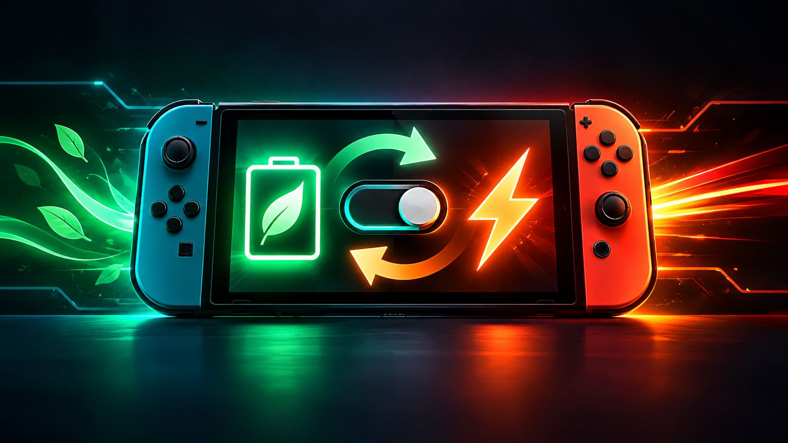
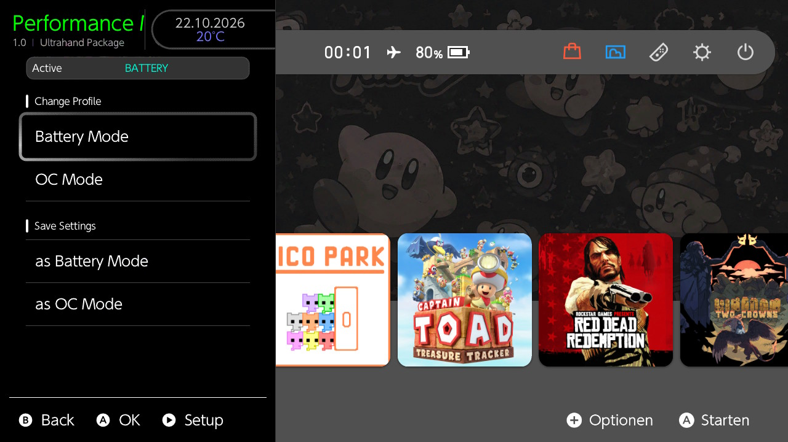

# Performance Modes

**Performance Modes** is an Ultrahand package for Nintendo Switch that switches between two complete [Horizon OC](https://github.com/Horizon-OC/Horizon-OC) setups:

- **OC Mode** — your normal overclock/performance profile with the voltage, memory and clock headroom required for higher clocks.
- **Battery Mode** — a stock-clock undervolting / efficiency profile tuned specifically for battery life.

The package stores the complete Horizon OC configuration together with the active `hoc.kip`. Per-title Horizon clock profiles are therefore included automatically. If ReverseNX-RT is installed, its complete `ReverseNX-RT` settings folder is stored and restored with the selected mode as well.



## Why OC Mode + Battery Mode?

A normal OC setup is often tuned around the **highest CPU/RAM clocks the console can stably reach**. Reaching those clocks can require more VDD2/VDDQ and CPU voltage headroom than Nintendo stock-frequency gaming actually needs.

Battery Mode is therefore not intended as a second maximum-OC profile. It is a **stock-clock undervolting profile**: keep Nintendo stock handheld operating points, then tune the voltage headroom only as low as your own console remains stable.

- **OC Mode** keeps the headroom needed for higher CPU/GPU/RAM clocks.
- **Battery Mode** uses stock handheld clocks and can be tuned specifically for efficiency and battery life.

On Mariko/OLED systems, useful Battery-profile tuning controls can include **VDD2**, **VDDQ**, **CPU High UV** and the GPU voltage points required by stock handheld clocks. Every chip and RAM setup is different, so stability testing is essential.

See the [Battery tuning guide](docs/BATTERY_TUNING.md) for a practical walkthrough.

### Example battery-life result

On the development OLED, Red Dead Redemption was tested at the **same stock game clocks/settings** with **50% display brightness** and **0% volume**:

| Setting | Stock — no OC/UV profile | OC Mode profile | Battery Mode profile |
| --- | ---: | ---: | ---: |
| VDD2 | 1175 mV | 1087.5 mV | ~912.5 mV |
| VDDQ | 600 mV | 600 mV | 400 mV |
| Runtime | 4 h 56 min | 5 h 32 min | 6 h 05 min |

Compared with **OC Mode**, Battery Mode ran **33 minutes longer**, or about **+9.9% runtime**. For the same usable battery energy, that corresponds to roughly **9.0% lower average whole-device power draw** during that test.

Compared with the **true stock baseline**, Battery Mode ran **69 minutes longer**, or about **+23.3% runtime**, corresponding to roughly **18.9% lower average whole-device power draw**. Even the OC Mode voltage profile ran **36 minutes / +12.2% longer than stock**, corresponding to roughly **10.8% lower average whole-device power draw** at the same game clocks/settings.

This is one console and one workload, not a guaranteed result. Actual benefit depends on silicon quality, RAM, voltages, game workload, display brightness, battery condition and the settings used in both profiles.

## Features

- One-action **Battery Mode ↔ OC Mode** switching with an intentional CFW reboot.
- Automatically saves the mode you are leaving before loading the other one.
- Stores the complete `/config/horizon-oc/config.ini` per mode.
- Stores `/atmosphere/kips/hoc.kip` per mode.
- Automatically includes all current and future Horizon OC title-ID app profiles because the full config file is saved.
- Optional **ReverseNX-RT** settings are silently saved/restored by copying the complete `/SaltySD/plugins/ReverseNX-RT` folder with each mode.
- **Reset Battery App Profiles -> STOCK** resets Battery per-title clock overrides while preserving Battery's global Horizon OC `[values]` settings.
- Manual **Safety Backup / Restore**.
- Safety state: if the package cannot confirm whether Battery Mode or OC Mode is active, it does **not** overwrite either stored profile.
- **Check Files** verifies the four core files and reports `All 4 files: OK` when all are present.

The reboot after changing mode is intentional and required: the active `hoc.kip` is replaced during the switch, and CFW must restart so the selected KIP/profile is actually loaded.

## Requirements

- Nintendo Switch running Atmosphère/CFW.
- [Ultrahand Overlay](https://github.com/ppkantorski/Ultrahand-Overlay) — current release recommended.
- [Horizon OC](https://github.com/Horizon-OC/Horizon-OC).
- Optional: [ReverseNX-RT](https://github.com/masagrator/ReverseNX-RT) with SaltyNX.

> [!WARNING]
> Performance Modes does not validate overclock or undervolt values. Horizon OC settings can cause instability and, if misused, may risk data corruption. Use settings that are stable on your own console and keep appropriate backups.
>
> If a voltage/UV setting is too aggressive and normal CFW no longer boots, use your **Hekate `CFW no OC` / safe boot entry** (if your setup provides one), correct the value in Horizon OC or HOC Toolkit, save/apply it, then reboot into normal CFW. Performance Modes does not create or modify that Hekate entry.

## Installation

1. Download `Performance-Modes-v1.0.zip` from the `dist` folder or from the GitHub `v1.0` release.
2. Extract it to the **root of the SD card**.
3. Confirm this path exists:
   ```text
   /switch/.packages/Performance Modes/package.ini
   ```
4. Reboot/open Ultrahand and go to **Packages -> Performance Modes**.

The package does not ship personal Horizon OC settings, `hoc.kip` profiles or backups. Those are created on your console.

## Menu layout

```text
Main
  Current Profile

  Change Profile
    Battery Mode
    OC Mode

  Save Settings
    as Battery Mode
    as OC Mode

Setup
  Initial Setup
    Reset Battery App Profiles -> STOCK
    Mark Current Boot -> Battery
    Mark Current Boot -> OC Mode
    Check Files

  Backup Files
    Create Safety Backup
    Restore Safety Backup
```

## First-time setup

For the first setup, **start by booting the normal OC configuration you want to keep as OC Mode**. Save that profile first; only then create and tune Battery Mode.

1. Boot your normal OC configuration.
2. Open **Setup** and choose **Mark Current Boot -> OC Mode**.
3. On **Main**, choose **Save Settings -> as OC Mode**.
4. Without changing anything yet, choose **Save Settings -> as Battery Mode**. This creates a temporary Battery clone so the first switch is safe.
5. Choose **Battery Mode**. The console saves OC Mode, loads the temporary Battery clone and reboots.
6. Prepare the Battery baseline:
   - In **Horizon OC**, turn **Uncapped Clocks OFF**.
   - Set **RAM Max Clock = 1600 MHz**.
   - Keep GPU behavior at stock handheld clocks; **384 MHz** is the highest relevant stock handheld GPU point.
   - Do not keep per-game CPU/GPU/RAM OC overrides in Battery Mode if the goal is a true stock-clock efficiency profile.
   - In **HOC Toolkit**, set **CPU Max Clock = 1785 MHz** and **CPU Boost Clock = 1785 MHz**.
7. Horizon OC itself may not offer 1785 MHz in those two maximum-clock selectors. Set both values in **HOC Toolkit**, save/apply the HOC configuration, and reboot CFW so the updated `hoc.kip` is loaded.
8. Tune **VDD2**, **VDDQ**, **CPU High UV** and the required stock GPU voltage points one area at a time. See the [Battery tuning guide](docs/BATTERY_TUNING.md).
9. After the Battery settings are stable, use **Save Settings -> as Battery Mode** as a checkpoint.
10. Choose **OC Mode**. The OC profile is restored and CFW reboots.
11. If you want Battery games to use stock/default app clocks, open **Setup -> Reset Battery App Profiles -> STOCK** while **OC Mode is active**.
12. Open **Setup -> Check Files**. When all four core files are present, it reports `All 4 files: OK`.
13. Optionally choose **Create Safety Backup** once both modes are known-good.

For a shorter operational version, see [Setup and Usage Guide](docs/SETUP.md).

## Normal use

After setup, normal operation is intentionally simple:

- **Battery Mode**: saves the current OC Mode files and ReverseNX-RT folder, restores Battery files and ReverseNX-RT folder, sets the state to `BATTERY` and reboots.
- **OC Mode**: saves the current Battery files and ReverseNX-RT folder, restores the OC Mode files and ReverseNX-RT folder, sets the state to `OC Mode` and reboots.

You normally do **not** need to manually save after changing Horizon OC settings. The outgoing mode is automatically saved when you switch modes.

The manual **Save Settings** entries are useful during initial setup or when you intentionally want to overwrite one stored mode without switching.

## Horizon app profiles

Horizon OC stores its per-game CPU/GPU/RAM profiles inside the same `config.ini` that Performance Modes saves. Those app profiles therefore automatically change together with Battery Mode / OC Mode.

If you want the Battery profile to use stock/default game clocks, choose:

`Setup -> Reset Battery App Profiles -> STOCK`

This action is intentionally allowed **only while OC Mode is active**. If Battery Mode is active, nothing is changed and the package tells you to switch to OC Mode first.

## What is saved per mode?

```text
Battery/
├── config.ini          # full Horizon OC config, including title-ID app profiles
├── hoc.kip             # Horizon OC KIP configuration
└── ReverseNX-RT/       # optional complete ReverseNX-RT settings folder

OCMode/
├── config.ini
├── hoc.kip
└── ReverseNX-RT/
```

The active source files are:

```text
/config/horizon-oc/config.ini
/atmosphere/kips/hoc.kip
/SaltySD/plugins/ReverseNX-RT/        # optional
```

Performance Modes copies the complete ReverseNX-RT settings folder; it does not replace the ReverseNX-RT application itself.

## Internal state

The package state values are:

- Battery Mode: `BATTERY`
- OC Mode: `OC Mode`

Older installs that still contain `PERFORMANCE` are migrated automatically to `OC Mode` when the package boots. The OC profile files are stored under `OCMode/`.

## Safety behavior

- An automatic profile save only occurs when the current state is an exact confirmed match.
- `UNSET`, a missing value, or an unexpected value never overwrites Battery Mode or OC Mode during a mode switch.
- `Mark Current Boot` only changes this local state marker. Use it only when you know which profile was actually loaded for the current boot.
- A separate Hekate safe/no-OC boot entry is not modified by this project.

## Safety Backup

**Create Safety Backup** stores the current active Horizon config/KIP, both stored modes, the complete optional ReverseNX-RT snapshots, and the package state under the package's `Backup/` directory.

**Restore Safety Backup** writes that snapshot back and reboots CFW.

The backup is replaced only when you explicitly run **Create Safety Backup**.

## Updating

Future updates should be extracted over the existing package folder unless release notes say otherwise. User-generated `Battery/`, `OCMode/`, `Backup/` and `config.ini` files are not included in release ZIPs and therefore are not intentionally replaced by the project package.

## Credits

- [Ultrahand Overlay](https://github.com/ppkantorski/Ultrahand-Overlay) by ppkantorski and contributors.
- [Horizon OC](https://github.com/Horizon-OC/Horizon-OC) and its contributors.
- [ReverseNX-RT](https://github.com/masagrator/ReverseNX-RT) / SaltyNX by MasaGratoR and contributors.

Performance Modes is an independent community package and is not affiliated with Nintendo, the Ultrahand project, Horizon OC, or ReverseNX-RT.

## License

MIT. See [LICENSE](LICENSE).
